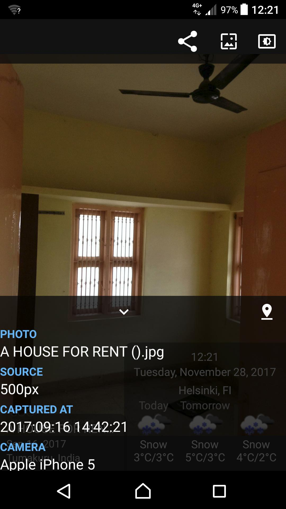
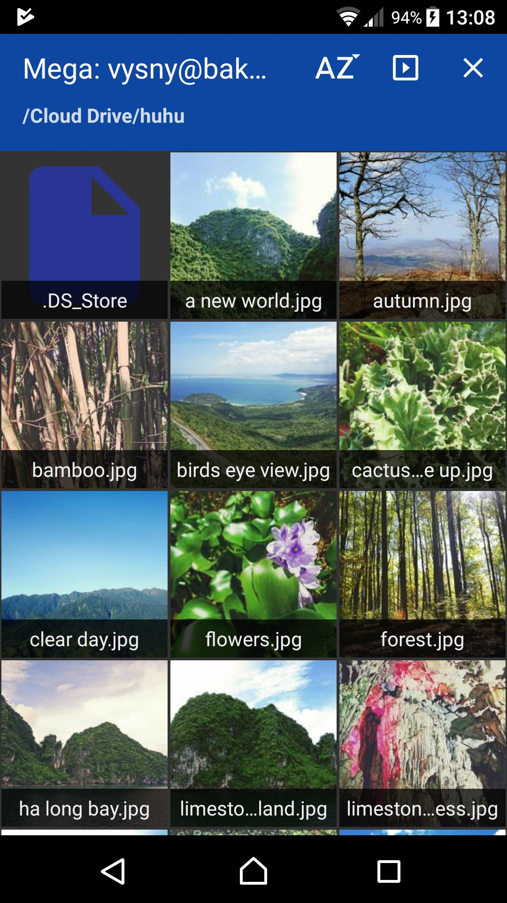

# PhotoCloud

Android Digital Frame App for Tablet and Phone.

Turn an old Android tablet or phone into a digital photo frame. Sit back and watch your photos
with your family: PhotoCloud shows a slideshow of photos from your own devices, your home network
and your cloud storage. No fluff, no bloat: an old-school app that is simple to use and just works.

Shows photos from any combination of these sources:
- Local Gallery (photos on the device)
- [ownCloud](https://owncloud.com/)/[Nextcloud](https://nextcloud.com/) server,
  even with a self-signed https certificate
- Windows shares (Samba / SMB)
- SSH / SFTP servers
- DLNA / UPnP media servers
- [Dropbox](https://www.dropbox.com/)
- [Microsoft OneDrive](https://onedrive.live.com/)
- [Box](https://www.box.com/)
- [Flickr](https://www.flickr.com/)
- [Mega](https://mega.nz/)
- [iCloud shared albums](https://support.apple.com/en-us/HT210910) (Public Share)

Google Photos and Google Drive are no longer supported; see the [FAQ](faq.html) for why.
You can still show them, and other sources too, by syncing them to the device with a sync app
such as FolderSync, then adding the synced folder to PhotoCloud;
see [this PhotoCloud mailing list thread](https://groups.google.com/g/photocloud-frame/c/EcH-pL4qprE).

Respects your privacy: PhotoCloud only reads your photos; it never changes, uploads or deletes
them. It is one of the few photo frame apps that work with your own Nextcloud/ownCloud server
(including self-signed https certificates), your own SFTP server or the photos on your Windows PC,
so your photos never have to leave your home.

## Features

- Plays all photos of a source, or only chosen folders and their subfolders, from any combination of sources
- Random or ordered playback, configurable delay, transitions and Ken Burns effect
- Photos are cached on the device; when offline, the slideshow goes on from the cache
- Clock, date, battery status and weather forecast on screen
- Shows EXIF data, the file name and where the photo was taken
- Moments: show only photos from a date range, or older photos less often
- Background music from the device
- Day and night brightness and dimming
- Starts automatically on boot or when the charger is connected (Android 9 and older; see the [FAQ](faq.html#launching-photocloud-at-boot-up-time))
- Browse the photos of a source by hand
- Cast the slideshow to your TV with Chromecast
- Works as the Android screen saver (Daydream)

Supported image types:
- bitmap: jpg, jpeg, png, gif, bmp, webp
- HEIF / HEIC: enable in Settings / Filters/Moments / Include HEIF/HEIC in Slideshow.
  Android 9 and newer decode it natively; on older Androids PhotoCloud uses its own
  experimental decoder.
- raw: crw, cr2, nef, raf, dng, mos, kdc, dcr. Off by default, since RAWs are large and
  generate huge network traffic; enable in Settings / Filters/Moments / Include RAWs in Slideshow.

Please note: this is just a digital frame and photo browser. It doesn't edit photos, create
videos or replace your gallery app. It does one thing - shows a slideshow of your photos -
and does it simply and right.

A slideshow from network or cloud sources downloads a lot of data, so PhotoCloud waits for
Wi-Fi or another unmetered connection by default (Settings / Metered Connection Protection).

Ideas, bugs and questions are welcome at
the [bug tracker page](https://github.com/mvysny/photocloud-frame-slideshow/issues).

## Screenshots

Streams | Slideshow | Browser
------------ | ------------- | -----
Welcome screen with the streams | A paused slideshow, showing EXIF and the location
where the photo was taken | You can browse the stream for photos and files
 |  | 

A short 3 minute introduction video:

## Pricing

PhotoCloud is a [free download at Google Play](https://play.google.com/store/apps/details?id=sk.baka.photoframe).
No ads, no subscription. There are two separate one-time in-app purchases:

* The “Remove Nagging Screen” purchase removes the “please purchase” image the free version
  shows once in a while during the slideshow;
* The “Daydream” purchase lets PhotoCloud run as the Android screen saver (Daydream), which
  starts when the device is charging or docked.

The in-app purchases are located in PhotoCloud Settings - simply touch the appropriate item to launch Google Play purchase process.
If the "Purchase" items are missing, it could be that the In-App Purchases API
is not available on your device (for example Amazon Fire tablet with Google Play). To verify that, please open the About Dialog and scroll to the bottom: in the "System stats" Section there will be
the "In-App Purchases API available:" line. If it says "false", then unfortunately the In-App Purchases API is not available on your device, which means two things:

* You can't unlock the features of this app from such device;
* Even if you use another device to purchase the features, these features still won't be unlocked on this device.

In such case please don't use in-app purchases.

## Offline Licenses

Offline Licenses are no longer available. PhotoCloud is only available on Google Play.

# Privacy Policy

See [Privacy Policy](privacy_policy.html) for more details.

## Required permissions

- `INTERNET` - to download photos from network and cloud sources, the weather forecast, Chromecast
- `READ_MEDIA_IMAGES` (Android 13+), `READ_EXTERNAL_STORAGE` (Android 12 and older) - the Local Gallery source;
  asked for only once you add a Gallery stream
- `READ_MEDIA_AUDIO` (Android 13+), `READ_EXTERNAL_STORAGE` (Android 12 and older) - the background music;
  asked for only once you set up background music
- `BILLING` - In-app purchases
- `ACCESS_NETWORK_STATE` - to wait for Wi-Fi or another unmetered network, avoiding mobile data charges
- `RECEIVE_BOOT_COMPLETED` - to automatically start the slideshow on boot (if so configured; Android 9 and older)
- `ACCESS_WIFI_STATE`, `CHANGE_WIFI_MULTICAST_STATE` - to discover DLNA devices
- `WAKE_LOCK` - to keep Wi-Fi awake while talking to DLNA devices
- `FOREGROUND_SERVICE` - Chromecast, and the auto-start service on Android 8-9

PhotoCloud 1.15.8 and older also asked for `WRITE_EXTERNAL_STORAGE` (photo cache on older Androids)
and `GET_ACCOUNTS` (Google Drive).

# Devices Support

PhotoCloud needs Android 5.0 (API level 21) or newer; it runs on phones and tablets.
Android 4.x and older are not supported.

## Unsupported Devices

It has been reported that [in-app payments on the Amazon Fire tablets with Google Play installed do not work](https://groups.google.com/forum/#!topic/photocloud-frame/YGF8EFPA3E4) -
the payment goes through but the annoying "Please Purchase" image stays. Please do not use PhotoCloud's in-app purchases if you plan to use the app on the Amazon Fire tablet.

Also, *Android TV* is **not** supported at the moment; see [bug #198](https://github.com/mvysny/photocloud-frame-slideshow/issues/198) for more details.
In short: Google rejected an update because of a vague Android TV requirement and didn't reply to e-mails,
so PhotoCloud is no longer offered on Android TV in Google Play. You can still show the slideshow on your TV with Chromecast.

# Links

* [Discussions forums](https://groups.google.com/forum/#!forum/photocloud-frame)
* [Bugs, issues, feature requests](https://github.com/mvysny/photocloud-frame-slideshow/issues)

# FAQ

Located here: [Frequently Asked Questions](faq.html)
